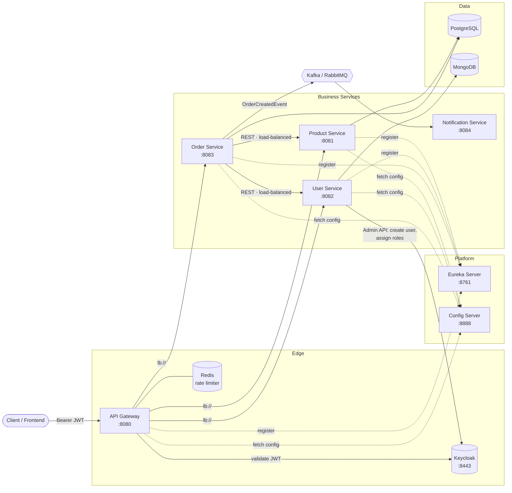
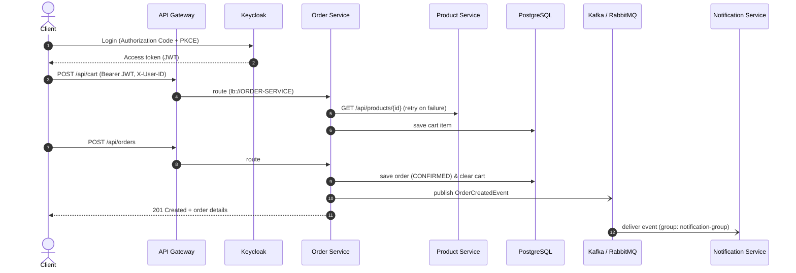

<div align="center">

# 🛒 E-Commerce Microservices Platform

**A production-style e-commerce backend built with Spring Boot & Spring Cloud.**
Service discovery, centralized config, an API gateway with rate limiting and circuit breakers,
OAuth2 security with Keycloak, event-driven messaging with Kafka / RabbitMQ, and full observability.


</div>

---

## 📑 Table of Contents

- [Overview](#-overview)
- [Architecture](#-architecture)
- [Services](#-services)
- [Tech Stack](#-tech-stack)
- [Key Features](#-key-features)
- [Order Flow](#-order-flow)
- [Getting Started](#-getting-started)
- [API Reference](#-api-reference)
- [Observability](#-observability)
- [Project Structure](#-project-structure)
- [Documentation](#-documentation)

---

## 🔭 Overview

The platform splits a classic online store into small, independently deployable services.
Clients talk to a single **API Gateway**, which authenticates every request against **Keycloak**,
applies rate limiting and resilience policies, and routes traffic to the right service found through **Eureka**.

All services pull their configuration from a central **Config Server**, and configuration changes are
broadcast at runtime through **Spring Cloud Bus**. When an order is placed, the Order Service publishes an
`OrderCreatedEvent` that the Notification Service consumes asynchronously through **Spring Cloud Stream**.

---

## 🏗 Architecture



---

## 🧩 Services

| Service | Port | Responsibility | Storage | Repository |
|---|---|---|---|---|
| **API Gateway** | `8080` | Single entry point, JWT validation, routing, rate limiting, retries, circuit breaker | Redis | [`gateway/`](gateway) |
| **Eureka Server** | `8761` | Service registry & discovery | — | [`eureka/`](eureka) |
| **Config Server** | `8888` | Centralized configuration (native backend) + Spring Cloud Bus | — | [`configserver/`](configserver) |
| **Product Service** | `8081` | Product catalog CRUD | PostgreSQL | [arafadev/product-service](https://github.com/arafadev/product-service) |
| **User Service** | `8082` | User management, provisions users & roles in Keycloak | MongoDB | [arafadev/user-service](https://github.com/arafadev/user-service) |
| **Order Service** | `8083` | Cart & checkout, calls Product/User services, publishes order events | PostgreSQL | [arafadev/order](https://github.com/arafadev/order) |
| **Notification Service** | `8084` | Consumes `OrderCreatedEvent` (Spring Cloud Function) | — | [`notification/`](notification) |

> **Note:** Product, User and Order services live in their own Git repositories and are included here as
> **Git submodules**. Clone with `--recurse-submodules` to get them (see [Getting Started](#-getting-started)).

---

## 🛠 Tech Stack

| Area | Technologies |
|---|---|
| **Language & Framework** | Java 17 / 21, Spring Boot 4, Spring Web MVC, Spring WebFlux (gateway) |
| **Spring Cloud** | Gateway, Netflix Eureka, Config Server, Cloud Bus, Cloud Stream, Cloud Function, LoadBalancer |
| **Security** | Keycloak 26, OAuth2 Resource Server (JWT), Authorization Code + PKCE, Keycloak Admin REST API |
| **Messaging** | Apache Kafka, RabbitMQ (switchable Spring Cloud Stream binders) |
| **Persistence** | PostgreSQL 14 (Spring Data JPA), MongoDB (Spring Data MongoDB), Redis |
| **Resilience** | Resilience4j: circuit breaker, retry, rate limiter · Redis-backed gateway rate limiter |
| **Inter-service calls** | `RestClient` + HTTP Interface clients (`HttpServiceProxyFactory`) with `@LoadBalanced` |
| **Observability** | Micrometer, Prometheus, Grafana, Loki, Grafana Alloy, Zipkin |
| **Containers** | Docker, Docker Compose, Jib (daemonless image builds) |
| **Testing tools** | JMeter (gateway rate-limit test plan), Postman |

---

## ✨ Key Features

- **API Gateway** – routes `/api/products/**`, `/api/users/**`, `/api/orders/**` and `/api/cart/**` to services resolved through Eureka (`lb://`).
- **Rate limiting** – Redis token bucket (`10 req/s`, burst `20`) keyed by client host on the product route.
- **Circuit breaker + fallback** – the `ecomBreaker` circuit opens at a 50% failure rate and forwards to `/fallback/products` with a friendly `503`.
- **Retries** – idempotent `GET` requests to the Product Service are retried at the gateway; the Order Service retries calls to the Product Service with Resilience4j.
- **OAuth2 / OpenID Connect** – every request through the gateway needs a valid Keycloak JWT; client roles from `resource_access` are mapped to Spring `ROLE_*` authorities.
- **User provisioning** – the User Service creates the user in Keycloak through the Admin API and assigns client roles automatically.
- **Event-driven communication** – the Order Service publishes with `StreamBridge`; the Notification Service consumes with a functional `Consumer<OrderCreatedEvent>`. The broker (Kafka or RabbitMQ) is a configuration choice, not a code change.
- **Centralized, refreshable config** – per-service and per-profile (`*-docker.yml`) files in the Config Server, refreshed at runtime through Spring Cloud Bus.
- **Full observability** – metrics (Prometheus → Grafana), centralized logs (Alloy → Loki → Grafana) and distributed tracing (Zipkin).

---

## 🔄 Order Flow



---

## 🚀 Getting Started

### Prerequisites

- **JDK 21** (some services target 17; 21 builds them all)
- **Docker** & **Docker Compose**
- **Maven** (or use the bundled `./mvnw` wrapper)

### 1. Clone the repository

```bash
git clone --recurse-submodules https://github.com/arafadev/microservices_ecommerce.git
cd microservices_ecommerce
```

Already cloned without submodules? Run `git submodule update --init`.

### 2. Configure environment variables

```bash
cp deploy/docker/.env.example deploy/docker/.env
# edit deploy/docker/.env and set real passwords
```

| Variable | Used by | Example |
|---|---|---|
| `DB_USER` / `DB_PASSWORD` | Product, Order | `postgres` / `****` |
| `MONGO_URI` | User | `mongodb://mongo:27017/ecom_user` |
| `RABBITMQ_HOST` / `RABBITMQ_PORT` | Config Server, all services (Cloud Bus) | `rabbitmq` / `5672` |
| `RABBITMQ_USERNAME` / `RABBITMQ_PASSWORD` / `RABBITMQ_VHOST` | Config Server, all services | `guest` / `****` / `/` |
| `ZIPKIN_URL` | Gateway | `http://zipkin:9411/api/v2/spans` |

### 3. Start the infrastructure

```bash
cd deploy/docker
docker compose up -d postgres mongo redis rabbitmq zookeeper kafka keycloak zipkin
```

### 4. Configure Keycloak

1. Open the admin console at <http://localhost:8443> (`admin` / `admin` in dev).
2. Create the realm **`ecom-app`**.
3. Create a public client **`oauth2-pkce`** (Standard flow + PKCE `S256`) and add client roles such as `USER`, `PRODUCT`, `ORDER`.
4. For user provisioning, give the account used by the User Service the `manage-users` and `view-clients` roles from `realm-management`.

Step-by-step notes live in [`docs/4- Securing eCommerce Microservices Project with Keycloak + OAuth2`](docs).

### 5. Run the services

Start them in this order (each in its own terminal):

```bash
(cd configserver    && ./mvnw spring-boot:run)   # 1. config first
(cd eureka          && ./mvnw spring-boot:run)   # 2. registry
(cd product-service && ./mvnw spring-boot:run)
(cd user-service    && ./mvnw spring-boot:run)
(cd order-service   && ./mvnw spring-boot:run)
(cd notification    && ./mvnw spring-boot:run)
(cd gateway         && ./mvnw spring-boot:run)   # last: entry point
```

> The Config Server reads `configserver/src/main/resources/config/`, whether you start it from `configserver/`
> or from the repository root. To use another folder, set
> `SPRING_CLOUD_CONFIG_SERVER_NATIVE_SEARCH_LOCATIONS=/absolute/path/to/config`.

Open the Eureka dashboard at <http://localhost:8761> and check that every service is **UP**.

### 🐳 Run everything with Docker

Images are built with **Jib** (no Dockerfile needed):

```bash
(cd product-service && ./mvnw compile jib:dockerBuild)
# repeat for each service, then:
cd deploy/docker
docker compose up -d
```

Services started with the `docker` profile load `*-docker.yml` from the Config Server, which points
them at container hostnames (`postgres`, `mongo`, `rabbitmq`, `keycloak`, …) instead of `localhost`.

---

## 📡 API Reference

All requests go through the gateway at `http://localhost:8080` and need an
`Authorization: Bearer <access_token>` header.

### Products

| Method | Endpoint | Description |
|---|---|---|
| `GET` | `/api/products` | List all products |
| `GET` | `/api/products/{id}` | Get a product |
| `POST` | `/api/products` | Create a product |
| `PUT` | `/api/products/{id}` | Update a product |
| `DELETE` | `/api/products/{id}` | Delete a product |
| `GET` | `/api/products/simulate?fail=true` | Force a failure to watch the circuit breaker open |

### Users

| Method | Endpoint | Description |
|---|---|---|
| `GET` | `/api/users` | List all users |
| `GET` | `/api/users/{id}` | Get a user |
| `POST` | `/api/users` | Create a user (also created in Keycloak with roles) |
| `PUT` | `/api/users/{id}` | Update a user |

### Cart & Orders

These endpoints identify the user with the `X-User-ID` header.

| Method | Endpoint | Description |
|---|---|---|
| `POST` | `/api/cart` | Add an item to the cart |
| `GET` | `/api/cart` | Get the current cart |
| `DELETE` | `/api/cart/items/{productId}` | Remove an item |
| `DELETE` | `/api/cart` | Clear the cart |
| `POST` | `/api/orders` | Place an order from the cart and publish `OrderCreatedEvent` |

<details>
<summary><b>Example requests</b></summary>

```bash
TOKEN="<access_token from Keycloak>"

# Create a product
curl -X POST http://localhost:8080/api/products \
  -H "Authorization: Bearer $TOKEN" \
  -H "Content-Type: application/json" \
  -d '{"name":"Keyboard","description":"Mechanical keyboard","price":79.99,"stockQuantity":50,"category":"Electronics"}'

# Add it to the cart
curl -X POST http://localhost:8080/api/cart \
  -H "Authorization: Bearer $TOKEN" \
  -H "X-User-ID: <user-id>" \
  -H "Content-Type: application/json" \
  -d '{"productId":1,"quantity":2}'

# Checkout
curl -X POST http://localhost:8080/api/orders \
  -H "Authorization: Bearer $TOKEN" \
  -H "X-User-ID: <user-id>"
```

</details>

---

## 📊 Observability

| Tool | URL | What you get |
|---|---|---|
| Eureka Dashboard | <http://localhost:8761> | Registered instances and their status |
| Grafana | <http://localhost:3000> | Dashboards for metrics (Prometheus) and logs (Loki) |
| Prometheus | <http://localhost:9090> | Scrapes `/actuator/prometheus` every 3s |
| Zipkin | <http://localhost:9411> | End-to-end traces across gateway and services |
| RabbitMQ Console | <http://localhost:15672> | Exchanges, queues, message rates |
| pgAdmin | <http://localhost:5050> | PostgreSQL administration |
| Actuator | `http://localhost:<port>/actuator` | Health, metrics, circuit breaker state |

Service logs are written to `logs/<service>.log` (rolling, 5 MB × 7 days) and shipped to Loki by Grafana Alloy.

---

## 📁 Project Structure

```text
ecom_microservice/
├── gateway/            # Spring Cloud Gateway (WebFlux) + OAuth2 resource server
├── eureka/             # Service registry
├── configserver/       # Config Server
│   └── src/main/resources/config/   # <service>.yml and <service>-docker.yml
├── product-service/    # nested repo → arafadev/product-service
├── user-service/       # nested repo → arafadev/user-service
├── order-service/      # nested repo → arafadev/order
├── notification/       # Event consumer (Spring Cloud Stream)
├── deploy/docker/      # docker-compose, Prometheus, Loki & Alloy config, DB init script
├── additional/         # Experiments: Kafka producer/consumer, Keycloak OAuth2 flow demos, Loki/Prometheus labs
└── docs/               # Study notes and HTML guides for every topic
```

---

## 📚 Documentation

The [`docs/`](docs) folder holds detailed guides written while building the project:

- Asynchronous communication with RabbitMQ
- Apache Kafka
- Moving to Spring Cloud Function & Spring Cloud Stream
- Securing the platform with Keycloak + OAuth2 (PKCE, roles, Admin API)
- Fault tolerance with Resilience4j
- Docker & containerization with Jib
- Eureka, inter-service communication and the full microservices lifecycle

---

<div align="center">

Built by [**arafadev**](https://github.com/arafadev) · If this project helped you, consider giving it a ⭐

</div>
